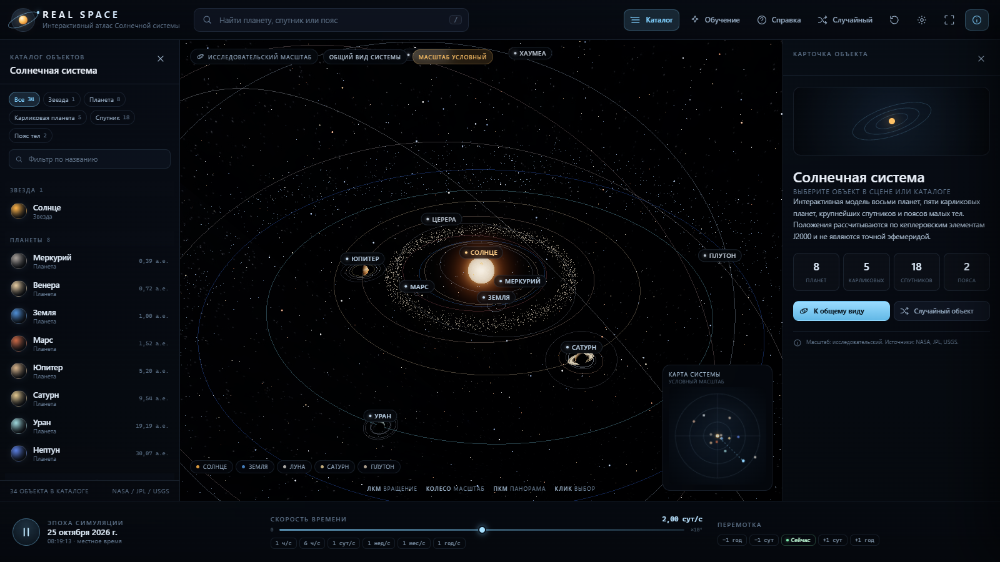
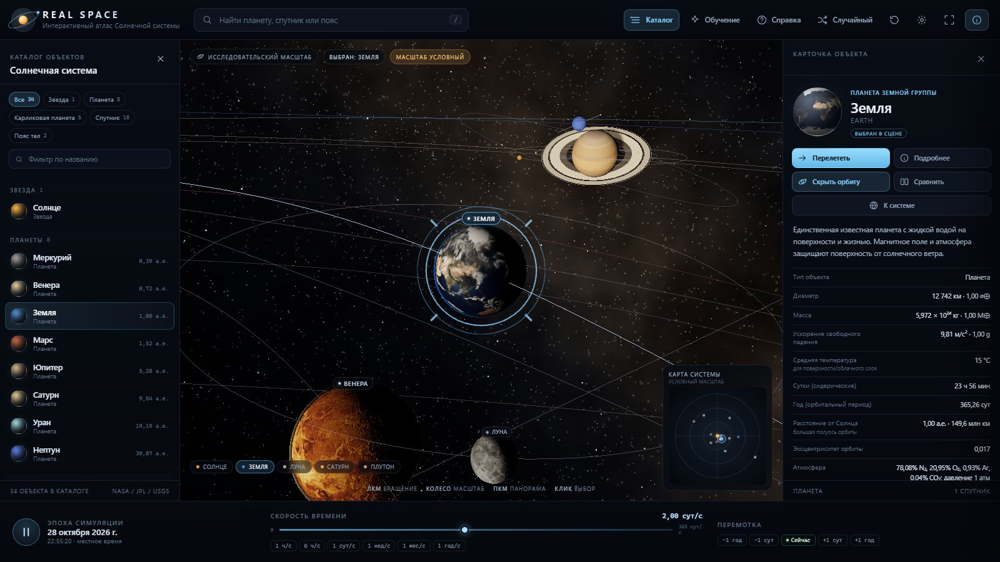
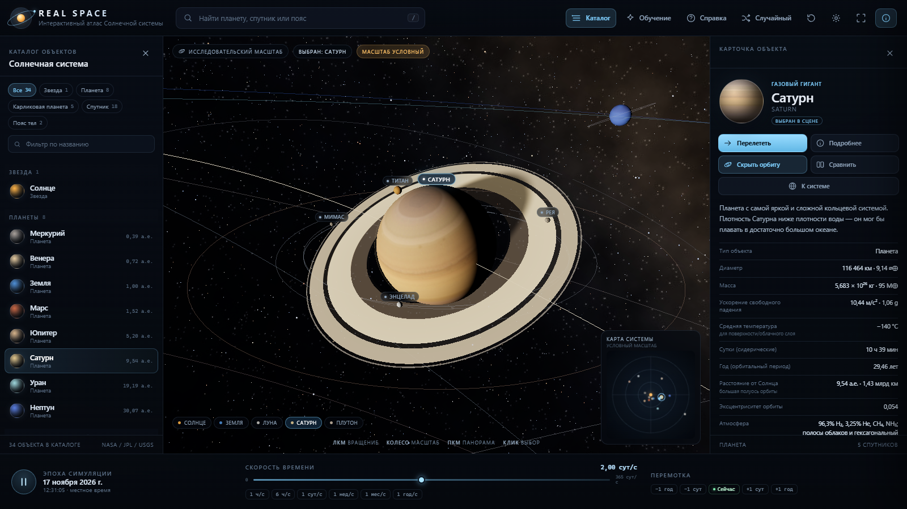
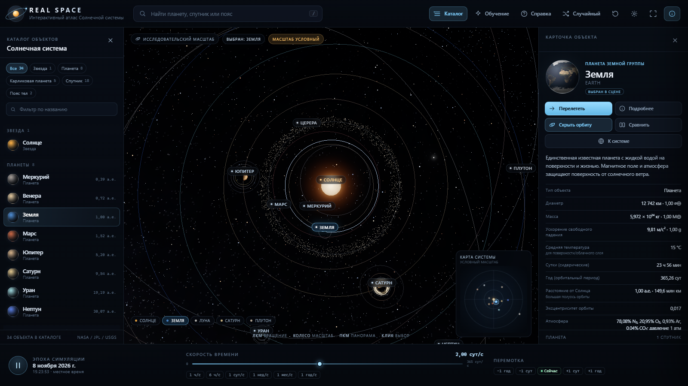
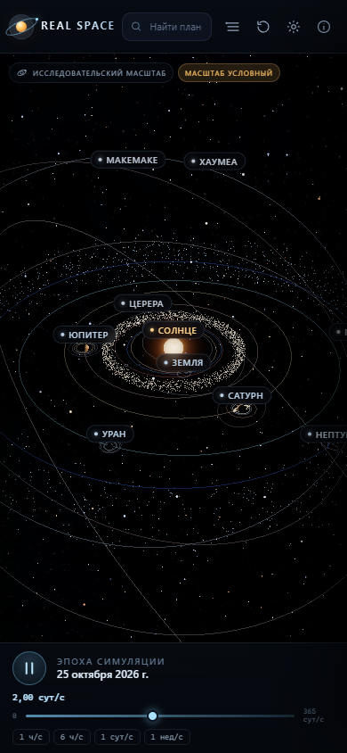

# REAL SPACE — интерактивный 3D-атлас Солнечной системы

Полноценное веб-приложение: настоящая 3D-сцена на Three.js, научные карточки объектов,
управляемое время, два режима масштаба, кольца Сатурна с тенью планеты, атмосфера и ночные
огни Земли, пояс астероидов и пояс Койпера, сравнение объектов и краткое обучение.

Интерфейс полностью на русском языке, адаптирован под компьютер и телефон.



## Скриншоты

| Земля и Луна | Сатурн и кольца |
| --- | --- |
|  |  |

| Вид сверху | Мобильный интерфейс |
| --- | --- |
|  |  |

## Быстрый запуск

Требуется Node.js 20+ и pnpm (или npm).

```bash
pnpm install
pnpm dev
```

Откройте адрес, который выведет Vite (по умолчанию `http://127.0.0.1:5174`).

Сборка и локальный предпросмотр production-версии:

```bash
pnpm build
pnpm preview
```

## Что реализовано

- **3D-сцена**: Солнце с шейдерной поверхностью, короной и bloom; 8 планет; Земля и Луна;
  18 крупных спутников; 5 карликовых планет; пояс астероидов и пояс Койпера; звёздное поле
  (до 16 000 звёзд) и процедурная полоса Млечного Пути.
- **Реалистичное освещение**: точечный источник в Солнце, терминатор, ночная сторона,
  атмосферные ободки, ночные огни Земли, тень Сатурна на кольцах (считается в шейдере).
- **Орбиты**: кеплеровские элементы J2000, эллиптические орбиты с наклонениями; планеты
  вращаются вокруг оси и движутся по орбитам с управляемой скоростью времени.
- **Камера**: вращение, зум, панорама, инерция, плавные перелёты, слежение за движущимся
  объектом, ограничения, сброс, предустановленные ракурсы («Сверху», «В плоскости орбит»).
- **Выбор объектов**: клик по сцене (raycast), подписи-кнопки, каталог, поиск, быстрый переход
  к Солнцу / Земле / Луне / Сатурну / Плутону, случайный объект.
- **Карточка объекта**: диаметр, масса, гравитация, расстояние, сутки и год, температура,
  атмосфера, состав, спутники, научные факты. Поля зависят от типа объекта.
- **Действия**: «Перелететь», «Подробнее» (полное досье с орбитальными элементами),
  «Показать/скрыть орбиту», «Сравнить» (две карточки с числовыми метриками), «К системе».
- **Настройки**: скорость времени, масштаб сцены, орбиты, подписи, спутники, пояса, Млечный
  Путь, яркость звёзд, свечение Солнца, атмосферы, облака, качество графики, bloom, ракурсы.
  Все настройки сохраняются в `localStorage`.
- **Два режима масштаба**:
  - «Исследование» — увеличенные планеты и сжатые расстояния, явная пометка «масштаб условный»;
  - «Научный» — пропорции расстояний и относительных размеров соблюдены, радиусы тел
    равномерно увеличены ради видимости (иначе планеты были бы меньше пикселя).
- **Интерфейс**: верхняя панель с поиском, каталог с фильтрами, карточка объекта, временная
  панель с перемоткой, мини-карта с положением камеры, обучение из 6 шагов, справка,
  полноэкранный режим, адаптивные панели-шторки на телефоне.
- **Устойчивость**: индикатор загрузки, обработка ошибок загрузки текстур (процедурные
  заглушки и бейдж), обработка потери WebGL-контекста, освобождение ресурсов при размонтировании,
  ограничение pixel ratio и отключение bloom на слабом качестве.

## Технологии

- React 19 + TypeScript
- Vite 8
- Three.js 0.186 (WebGL, EffectComposer, UnrealBloomPass, CSS2DRenderer)
- Собственный контроллер камеры и собственные GLSL-шейдеры (Солнце, атмосферы, ночные огни,
  кольца, звёзды)

## Структура проекта

```
src/
  App.tsx                 — состояние приложения, связь UI и движка
  components/             — TopBar, CatalogPanel, InfoPanel, TimeBar, SettingsPanel,
                            Modals (досье, сравнение, справка), Tour, Minimap, Icons
  data/bodies.ts          — научный датасет (34 объекта) и орбитальные элементы
  lib/format.ts           — форматирование чисел, дат, скоростей
  lib/bodyInfo.ts         — строки характеристик и метрики сравнения
  scene/engine.ts         — сцена, тела, орбиты, пояса, выбор, время, настройки
  scene/camera.ts         — орбитальная камера с инерцией и перелётами
  scene/shaders.ts        — GLSL-материалы
  scene/textures.ts       — загрузка текстур и процедурные заглушки
  scene/settings.ts       — настройки, пресеты качества, localStorage
  styles.css              — оформление интерфейса
public/textures/          — карты планет, спутников, колец, Млечного Пути
tools/generate_assets.py  — генерация процедурных карт и подготовка текстур
tools/final-test.mjs      — браузерный smoke/UI-тест (Puppeteer + Edge)
```

## Данные и научная честность

- Характеристики: NASA Planetary Fact Sheet, JPL Solar System Dynamics, NASA Solar System
  Exploration, USGS Astrogeology.
- Положения планет рассчитываются по приближённым кеплеровским элементам J2000. Это
  **не эфемерида**: возмущения планет не учитываются, положения карликовых планет и фаз
  спутников условны. В карточках такие объекты помечены.
- В «Научном» режиме относительные размеры и расстояния соблюдены, но радиусы всех тел
  увеличены на один и тот же коэффициент ради видимости. В «Исследовании» масштаб
  условный — об этом прямо сказано в интерфейсе.
- Границы стран и города не рисуются: соответствующих данных в проекте нет.
- Источник текстур: NASA / USGS / Solar System Scope (CC BY 4.0), карты, которых нет в
  открытом наборе (спутники, карликовые планеты), сгенерированы процедурно в
  `tools/generate_assets.py`.

## Проверено

Тест `tools/final-test.mjs` (Edge в headless-режиме, Puppeteer) проверял:

- загрузку приложения и отсутствие ошибок в консоли;
- наличие 8 планет и 34 объектов каталога;
- выбор объекта кликом по 3D-сцене и по подписи;
- вращение камеры перетаскиванием и зум колесом;
- смену скорости времени (дата действительно меняется);
- включение/выключение орбит;
- поиск («Титан»), досье, сравнение, обучение;
- научный режим и перелёт к Земле;
- отсутствие падения при недоступной текстуре (Jupiter + кольца Сатурна);
- узкий экран 390×844: панели-шторки, отсутствие горизонтального переполнения.

Скриншоты проверки лежат в `shots/`.

## Ограничения

- Точность положений — кеплеровская модель, а не эфемерида реального времени.
- Для 18 спутников и четырёх карликовых планет используются сгенерированные текстуры
  (в открытом наборе не было подходящих карт); это не фотометрия реальных поверхностей.
- Кольца Урана показаны схематично (узкие слабые кольца), кольца Юпитера не показаны.
- Пояс астероидов и пояс Койпера визуализированы точками (до 1 900 + 1 400 объектов),
  а не полным каталогом.
- На очень слабых GPU (или программном WebGL) возможна низкая частота кадров; выберите
  качество «Низкое» в настройках.
